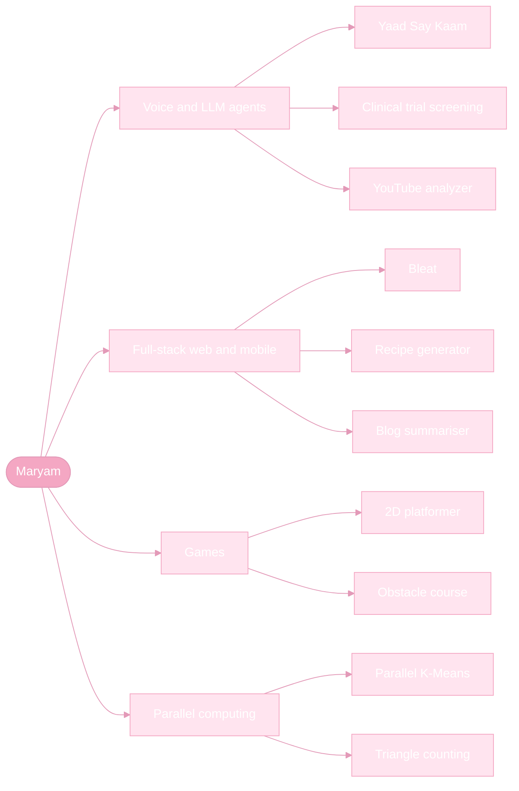

  
  

Curious by default, thorough by habit. I'm a computer science undergraduate at FAST-NUCES Islamabad who likes taking an idea all the way to something that actually runs: voice and LLM agents, full-stack apps, games, and the occasional piece of low-level parallel code.

 

|  |  |
|---|---|
| **Building** | voice agents, LLM-powered products, full-stack web and mobile apps |
| **Studying** | parallel and distributed computing, compilers, image processing |
| **Away from the keyboard** | calligraphy, creative writing |

 

### A map of what I build

 

### Selected work

| Project | What it is | Built with |
|---|---|---|
| [clinical_trial_matching_llm](https://github.com/Maryam-Faatima/clinical_trial_matching_llm) | Criterion-level clinical trial eligibility screening with a fine-tuned small transformer |   |
| [genai-restoration-sketch-studio](https://github.com/Maryam-Faatima/genai-restoration-sketch-studio) | Image restoration and face-to-sketch generation served through a web app |   |
| [Yaad-Say-Kaam](https://github.com/Maryam-Faatima/Yaad-Say-Kaam) | Task reminders pulled from email by a four-agent pipeline that strips personal data first |   |
| [ParallelKMeans](https://github.com/Maryam-Faatima/ParallelKMeans) | K-Means with OpenMP, MPI and OpenCL variants, benchmarked and analysed |    |
| [Bleat_ChildSecuritySystem](https://github.com/Maryam-Faatima/Bleat_ChildSecuritySystem) | Full-stack child safety management app |   |
| [Youtube_Video_Analyzer](https://github.com/Maryam-Faatima/Youtube_Video_Analyzer) | Summaries, Q&A and frame analysis for any YouTube video |   |
| [MerkleTreeReviewAnalyzer](https://github.com/Maryam-Faatima/MerkleTreeReviewAnalyzer) | Integrity checks for large product-review datasets |  |
| [RC_QUIZ](https://github.com/Maryam-Faatima/RC_QUIZ) | Quiz generation from reading-comprehension passages |   |

 

### Where I've worked

- Frontend developer intern, Sigma Evolution (current)
- AI developer intern on voice agents, TechLand (Feb to Jun 2026)
- Lab demonstrator, FAST-NUCES (Aug 2025 to Jan 2026)
- Game development intern, Elite Tech Solutions (Aug to Sep 2025)
- Web development intern, Nexium (Jul to Aug 2025)

 

### Along the way

  
  
  

 

### Tools I reach for

<table>
  <tr>
    <td>languages</td>
    <td></td>
  </tr>
  <tr>
    <td>web and backend</td>
    <td></td>
  </tr>
  <tr>
    <td>games and tooling</td>
    <td></td>
  </tr>
</table>

 

### Activity

  
  

  

